# Raphael Chernicharo Martins

**Estudante de Ciência da Computação • Cibersegurança Defensiva, Infraestrutura & Full-Stack**

Automação de sistemas, servidores Windows e Linux, virtualização em Proxmox VE e Hyper-V, desenvolvimento web com Python/FastAPI e TypeScript/React, e testes E2E com Playwright.

 

---

### Tecnologias & Ferramentas

<table>
  <tr>
    <td align="center" width="92">
       
      <b>Python</b>
    </td>
    <td align="center" width="92">
       
      <b>PowerShell</b>
    </td>
    <td align="center" width="92">
       
      <b>Bash</b>
    </td>
    <td align="center" width="92">
       
      <b>C#</b>
    </td>
    <td align="center" width="92">
       
      <b>TypeScript</b>
    </td>
    <td align="center" width="92">
       
      <b>JavaScript</b>
    </td>
    <td align="center" width="92">
       
      <b>HTML5</b>
    </td>
    <td align="center" width="92">
       
      <b>CSS3</b>
    </td>
  </tr>
  <tr>
    <td align="center" width="92">
       
      <b>React</b>
    </td>
    <td align="center" width="92">
       
      <b>Next.js</b>
    </td>
    <td align="center" width="92">
       
      <b>Tailwind</b>
    </td>
    <td align="center" width="92">
       
      <b>FastAPI</b>
    </td>
    <td align="center" width="92">
       
      <b>Node.js</b>
    </td>
    <td align="center" width="92">
       
      <b>Prisma</b>
    </td>
    <td align="center" width="92">
       
      <b>SQLite</b>
    </td>
    <td align="center" width="92">
       
      <b>Supabase</b>
    </td>
  </tr>
  <tr>
    <td align="center" width="92">
       
      <b>Linux</b>
    </td>
    <td align="center" width="92">
       
      <b>Windows</b>
    </td>
    <td align="center" width="92">
       
      <b>Docker</b>
    </td>
    <td align="center" width="92">
       
      <b>Git</b>
    </td>
    <td align="center" width="92">
       
      <b>GitHub</b>
    </td>
    <td align="center" width="92">
       
      <b>Actions</b>
    </td>
    <td align="center" width="92">
       
      <b>VS Code</b>
    </td>
    <td align="center" width="92">
       
      <b>Playwright</b>
    </td>
  </tr>
</table>

 

---

### Projetos em Destaque

| Projeto | Descrição | Stack Principal |
|---|---|---|
| [**Otimizador-Windows-10-11**](https://github.com/raphael-c-martins/Otimizador-Windows-10-11) | Executável nativo para debloat, hardening de sistema/rede, bloqueio de telemetria e IA, com diário para reversão exata. | C# / .NET 4.8 (WPF), Hardening |
| [**i-love-security**](https://github.com/raphael-c-martins/i-love-security) | Suíte 100% offline para edição, conversão e otimização de PDFs, BigTIFFs e imagens com privacidade local. | Python, FastAPI, Docker |
| [**media-studio**](https://github.com/raphael-c-martins/media-studio) | Ferramenta local para download de mídias e extração de frames de vídeo em resolução original. | FastAPI, Vanilla JS, OpenCV, PyAV, yt-dlp |
| [**raphael-c-martins.github.io**](https://github.com/raphael-c-martins/raphael-c-martins.github.io) | Currículo virtual e portfólio profissional construído do zero sem frameworks client-side. | HTML5, CSS3, Vanilla JS |

---

### Atividade de Contribuições

  <picture>
    <source media="(prefers-color-scheme: dark)" srcset="https://raw.githubusercontent.com/raphael-c-martins/raphael-c-martins/output/pacman-contribution-graph-dark.svg" />
    <source media="(prefers-color-scheme: light)" srcset="https://raw.githubusercontent.com/raphael-c-martins/raphael-c-martins/output/pacman-contribution-graph.svg" />
    
  </picture>

